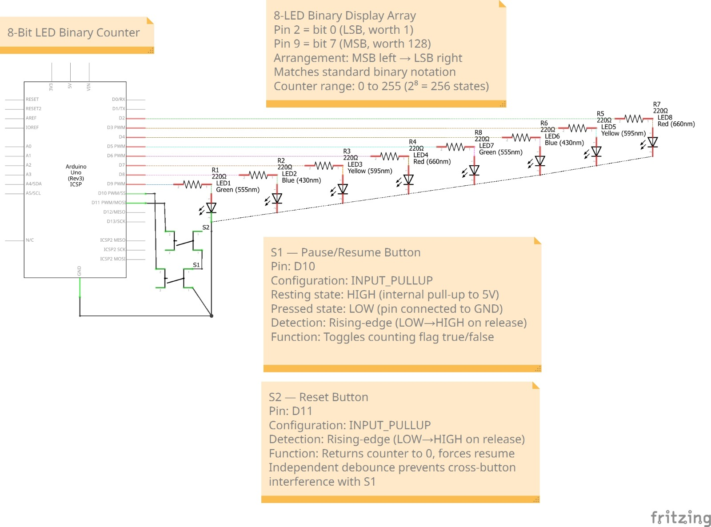

# Project 1 — 8-Bit LED Binary Counter

Eight LEDs count from **0 to 255** in binary. Each LED is one bit: **ON = 1**, **OFF = 0**. One button pauses and resumes the count, and the other resets it to zero.

This is the first of ten projects building toward an automated aquarium controller. I started here because every later project depends on the same basics: controlling outputs, reading buttons, and figuring out why something does not work.


## What it does

- Counts up every 500 ms and wraps from 255 back to 0.
- The pause button toggles counting on and off when I release it.
- The reset button sets the count to 0 and starts counting again, even if it was paused.
- Each button ignores extra presses for 200 ms after it triggers, so one press counts as one press.
- The Serial Monitor (9600 baud) shows each value in decimal and binary.

## Components

| Component | Quantity |
|---|---:|
| ELEGOO UNO R3 | 1 |
| LEDs (green, blue, yellow, red) | 8, two of each color |
| 220 Ω resistors | 8 |
| Push buttons | 2 |
| Breadboard | 1 |
| Jumper wires | As needed |
| USB cable | 1 |

## Wiring

Looking at the board from the front, the biggest bit (MSB) is on the left and the smallest bit (LSB) is on the right, the same way we write binary numbers.

| Arduino pin | What it connects to | Bit weight |
|---|---|---:|
| D9 | Leftmost LED, bit 7 (MSB) | 128 |
| D8 | Bit 6 | 64 |
| D7 | Bit 5 | 32 |
| D6 | Bit 4 | 16 |
| D5 | Bit 3 | 8 |
| D4 | Bit 2 | 4 |
| D3 | Bit 1 | 2 |
| D2 | Rightmost LED, bit 0 (LSB) | 1 |
| D10 | Pause/resume button | — |
| D11 | Reset button | — |
| GND | LED cathodes and both buttons | — |

Each LED goes pin → 220 Ω resistor → LED → GND. The resistor keeps the current safe for both the LED and the Arduino pin.

The buttons connect their pin to GND when pressed. I used `INPUT_PULLUP`, so the pin reads HIGH normally and LOW while pressed. No extra resistors are needed. The code acts when the pin goes back from LOW to HIGH, which is when I let go.

### Breadboard diagram


### Schematic



## How the binary display works

Eight bits give 2⁸ = 256 values, from `00000000` (0) to `11111111` (255). Each LED has a weight:

```text
Bit:       7   6   5   4   3   2   1   0
Weight:  128  64  32  16   8   4   2   1
```

For example, 13 = 8 + 4 + 1, which is `00001101`. The LEDs on D5, D4 and D2 light up.

The line `(val >> i) & 1` pulls out one bit. `>> i` shifts bit `i` down to the lowest position, and `& 1` throws away everything else. The result (0 or 1) goes straight into `digitalWrite()`.

## How to run it

1. Wire the circuit using the pin table and breadboard diagram.
2. Download [`Binary_Counter_4.ino`](Binary_Counter_4.ino) and open it in the Arduino IDE. If the IDE asks to create a folder for it, click OK.
3. Select the board and port, then upload.
4. Open the Serial Monitor at **9600 baud**.
5. Press and release the pause button to pause or resume. Press and release reset to go back to zero.

No extra libraries are needed.

## Problems I ran into

| Problem | Cause | Fix |
|---|---|---|
| One LED did not light | The cathode leg was not pushed in all the way | Reseated the LED |
| Button pin always read LOW | I wired two legs that are already connected inside the button | Moved the wires across the switch |
| Pause only worked while I held the button | My code followed the live button state | Added a flag that remembers paused or running |
| One release toggled more than once | Button contacts bounce | Raised the lockout from 50 ms to 200 ms |

Testing each LED by itself and printing the button states to the Serial Monitor helped me find wiring problems before putting the whole program together.

## What I would improve

The 200 ms lockout stops repeated triggers, but it is not true debouncing. It does not check that the button actually stayed released.

Also, `delay(500)` freezes the program while it counts. A very quick press and release during that half second can be missed. When the counter is paused, there is no delay, so buttons always work.

Next time I would use `millis()` for the counting timer and only accept a button change after it stays stable. I used exactly that `millis()` approach later in Project 5, and the aquarium controller will need it too, because it cannot freeze while it is watching temperature and timers.

## Testing checklist

| Check | Expected |
|---|---|
| Count 0 | All LEDs off |
| Count 13 | D2, D4, D5 on, the rest off |
| Count 255 | All LEDs on |
| Wraparound | 255 goes back to 0 |
| Pause | Display holds its value |
| Resume | Counting continues |
| Reset (running or paused) | Display goes to 0 and counting starts again |

## Photos, videos and report

- [First build: LEDs only](Project1_LED_Binary_Counter_Image_1.jpeg)
- [Second build: one button](Project1_LED_Binary_Counter_Image_2.jpeg)
- [Final build: two buttons](Project1_LED_Binary_Counter_Image_3.jpeg)
- [Demo video 1](Project1_LED_Binary_Counter_Video_1.mp4)
- [Demo video 2](Project1_LED_Binary_Counter_Video_2.mp4)
- [Project report (Word)](Project1_LED_Binary_Counter_R1.docx)
- [Arduino code](Binary_Counter_4.ino)

## What I learned

Seeing binary on real LEDs made it click for me in a way that writing 1s and 0s never did. The bigger lessons were about debugging: check the wiring one piece at a time, and understand the difference between what a button is doing right now and what the program should remember. That second idea, storing a state instead of reacting to a live input, came back in Project 5 and again in my keypad lock.

## Code

This is the same code as `Binary_Counter_4.ino`.

```cpp
const int ledPins[]  = {2,3,4,5,6,7,8,9};
const int pausePin   = 10;
const int resetPin   = 11;

int counter          = 0;
bool counting        = true;
unsigned long lastPauseDebounce = 0;
unsigned long lastResetDebounce = 0;
bool lastPauseState  = HIGH;
bool lastResetState  = HIGH;

void setup() {
  for(int i=0; i<8; i++) pinMode(ledPins[i], OUTPUT);
  pinMode(pausePin, INPUT_PULLUP);
  pinMode(resetPin, INPUT_PULLUP);
  Serial.begin(9600);
}

void displayBinary(int val) {
  for(int i=0; i<8; i++) {
    digitalWrite(ledPins[i], (val >> i) & 1);
  }
}

void loop() {
  // ── Pause button (rising edge detection) ──────────────
  bool currentPauseState = digitalRead(pausePin);
  if(lastPauseState==LOW && currentPauseState==HIGH
     && millis()-lastPauseDebounce>200) {
    counting = !counting;
    lastPauseDebounce = millis();
  }
  lastPauseState = currentPauseState;

  // ── Reset button (rising edge detection) ──────────────
  bool currentResetState = digitalRead(resetPin);
  if(lastResetState==LOW && currentResetState==HIGH
     && millis()-lastResetDebounce>200) {
    counter  = 0;
    counting = true;
    displayBinary(0);
    lastResetDebounce = millis();
    Serial.println("--- RESET ---");
  }
  lastResetState = currentResetState;

  // ── Counter ───────────────────────────────────────────
  if(counting) {
    displayBinary(counter);
    Serial.print("Decimal: "); Serial.print(counter);
    Serial.print("  Binary: ");
    for(int i=7; i>=0; i--) Serial.print((counter>>i)&1);
    Serial.println();
    counter = (counter+1) % 256;
    delay(500);
  }
}
```
