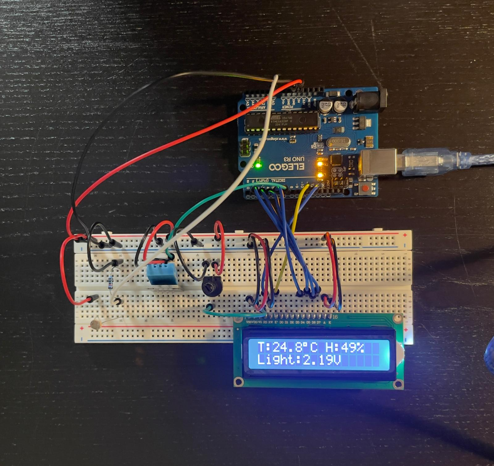
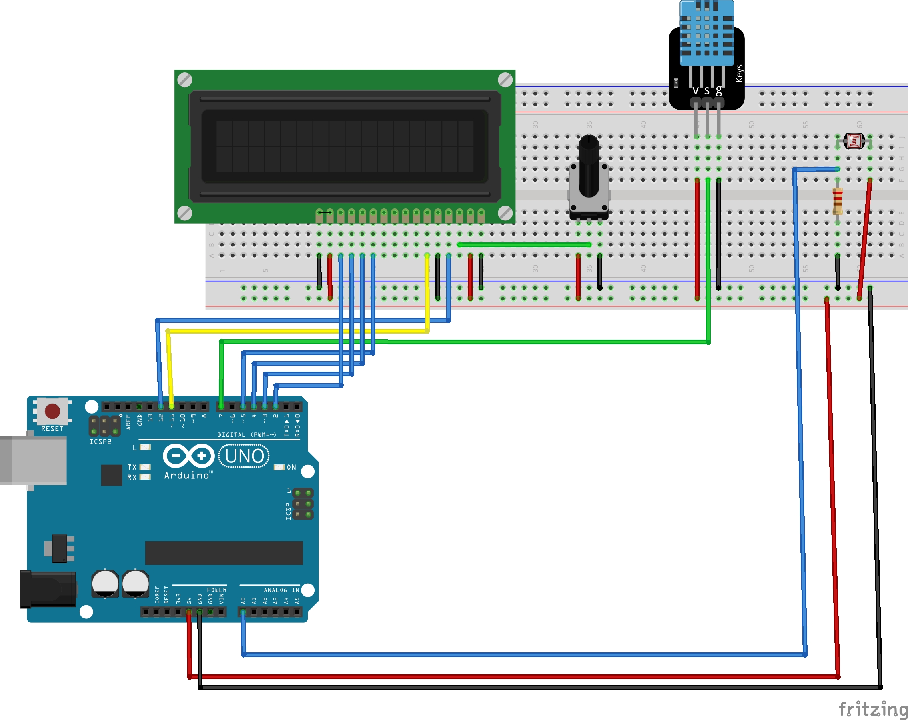
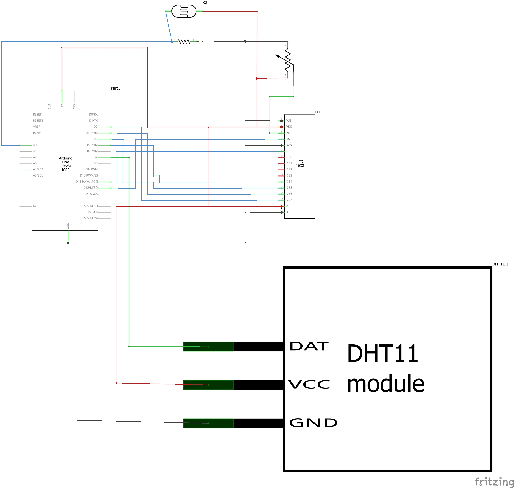
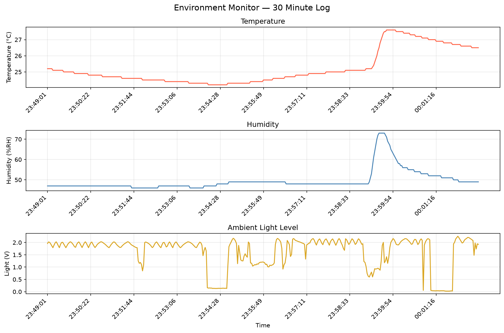

# Project 2 — Environment Monitor

This monitor measures temperature, humidity and light, shows them on a 16×2 LCD, and sends them to my computer, where a Python script logs them and draws a graph.

A DHT11 sensor measures temperature and humidity. A light-dependent resistor (LDR) measures light through a voltage divider. This was my first project with real sensors, and it is the start of the "monitoring" half of my aquarium controller. My aquarium failed partly because I could not see what was changing, so measuring and recording comes first.



## What it does

- Reads temperature, humidity and light about every 2 seconds.
- Shows all three on the LCD.
- Sends each reading to the Serial Monitor as one comma-separated line at 9600 baud.
- Checks every DHT11 reading with `isnan()` before using it, so a failed read shows an error instead of a fake number.
- A Python logger saves the readings to a CSV file with a timestamp and plots them.

## Components

| Component | What it does |
| --- | --- |
| ELEGOO UNO R3 | Reads the sensors and runs the LCD |
| DHT11 module | Temperature and humidity |
| LDR (light-dependent resistor) | Senses light |
| 10 kΩ resistor | Makes the voltage divider with the LDR |
| 16×2 LCD (LCD1602) | Shows the readings |
| 10 kΩ potentiometer | Sets the LCD contrast |
| Breadboard, jumper wires, USB cable | Connections and power |

## Wiring

| Signal | Arduino pin |
| --- | --- |
| DHT11 data | D7 |
| LDR divider midpoint | A0 |
| LCD RS | D12 |
| LCD E | D11 |
| LCD D4 | D5 |
| LCD D5 | D4 |
| LCD D6 | D3 |
| LCD D7 | D2 |
| Power for all modules | 5V |
| Common ground | GND |

The light sensor is wired as **5V → LDR → A0 → 10 kΩ → GND**. More light lowers the LDR's resistance, so the voltage at A0 goes up. The LCD's R/W pin goes to GND because I only write to the screen. The potentiometer's outer legs go to 5V and GND, and its middle leg goes to the LCD's V0 pin to set the contrast.

### Breadboard diagram



### Schematic



## How to run it

1. Wire the circuit using the table and diagrams.
2. In the Arduino IDE, install the **DHT sensor library by Adafruit** (it will also ask to install Adafruit Unified Sensor; say yes). `LiquidCrystal` is already built in.
3. Open [`Environment_Monitor_3.ino`](Environment_Monitor_3.ino), select the board and port, and upload.
4. Turn the potentiometer until the LCD text is clear.
5. Open the Serial Monitor at 9600 baud. You should see lines like `24.8,49.0,448`.
6. **Close the Serial Monitor** before running Python. Only one program can use the port at a time.
7. Install the Python libraries:

   ```sh
   python -m pip install pyserial matplotlib
   ```

8. Open [`logger.py`](logger.py) and set `PORT` to your Arduino's port (mine was `COM6`).
9. Run it:

   ```sh
   python logger.py
   ```

The logger is set to record for 30 minutes. Pressing Ctrl+C stops it early and still saves and plots the data.

**Honest note about Python:** Python is still new to me. I understand what the logger does, and I checked its output against the Serial Monitor before the full run, but I could not have written it from scratch on my own yet.

## The data

The Arduino sends three values per line:

```text
temperature_c,humidity_pct,light_raw
24.8,49.0,448
```

The logger adds the time and converts the light reading to volts:

```csv
time,temp_c,humid_pct,light_raw,light_volts
23:49:01,25.2,47,401,1.96
```

The conversion is `light_raw × 5.0 ÷ 1023`, because the Arduino's analog input turns 0–5 V into a number from 0 to 1023. This is the divider voltage, not real brightness in lux, so higher just means "brighter".

If the DHT11 fails to read, the LCD shows `DHT11 Error!`, the sketch waits 2 seconds and tries again. The logger skips that line because it is not three numbers.

## My results

I recorded **400 readings** from **23:49:01 to 00:02:36**, which is **13 minutes 35 seconds**, shorter than the 30 minutes the logger was set for. The recording crosses midnight, so the times go from 23:59 to 00:00.

| Reading | Lowest | Highest |
| --- | --- | --- |
| Temperature | 24.2 °C | 27.6 °C |
| Humidity | 46 % | 73 % |
| Light (divider voltage) | 0.024 V | 2.253 V |

To check that the sensors really responded, I did three things on purpose:

- **Covered the LDR** around 23:54. The light reading dropped to about 0.13–0.16 V and came back when I uncovered it.
- **Breathed on the DHT11** around 23:59. Humidity jumped to 73 % and temperature to 27.6 °C, then slowly fell back. By the end, humidity was 49 % and temperature 26.5 °C.
- **Turned off the room light** around 00:01. The light reading fell almost to zero, then went back to about 2 V when I turned it on.

This shows the monitor reacts to real changes. It does not prove the readings are accurate, because I did not compare them with a calibrated thermometer or hygrometer. There are smaller dips in the light graph too, probably from my hand or shadow, but I did not write down the exact times, so I can't say for sure. Next time I will keep a timestamped note of what I do.

The graph title still says "30 Minute Log" because that is the logger's setting. The real recording is 13 minutes 35 seconds.



## Problems I ran into

| Problem | Cause | Fix |
| --- | --- | --- |
| LCD backlight on but no text | RS was on pin 11 and E on pin 10, one pin off from what the code expects | Turned the contrast all the way and saw dark boxes, so the LCD was fine and the data wires were wrong. Moved RS to D12 and E to D11 |
| Serial Monitor showed labels like `Temp: 24.6C` instead of numbers | I had written the CSV version but not uploaded it, so the board was still running my Stage 2 test sketch | Uploaded the final sketch. The Arduino always runs the last upload, not whatever is open in the editor |
| Python ran but saved no data | The Serial Monitor was still open and using COM6 | Closed the Serial Monitor before starting the logger |

## What I learned

The biggest lesson was to never trust a sensor reading without checking it first. The `isnan()` check is a small line, but without it a bad DHT11 read would turn into a fake number on the screen and in my data. My aquarium controller will be switching a heater based on temperature, so a fake reading there could actually cause damage.

I also learned to report what my data actually shows, not what I planned. I set the logger for 30 minutes, but the CSV has 13 minutes 35 seconds, so that is what I report.

Logging to a file came back in Project 6, where I logged water temperature to an SD card so the Arduino can record without a computer.

## Files

| File | What it is |
| --- | --- |
| [Environment_Monitor_3.ino](Environment_Monitor_3.ino) | Arduino sketch |
| [logger.py](logger.py) | Python logger and graph script |
| [Project report R1](Project_2_Environment_Monitor_R1.docx) | Full write-up with code, troubleshooting and results |
| [CSV log](Project_2_Environment_Monitor_Log.csv) | All 400 readings |
| [Graph](Project_2_Environment_Monitor_Graph.png) | Temperature, humidity and light plots |
| [Breadboard diagram](Project_2_Environment_Monitor_Breadboard.jpg) | Circuit layout |
| [Schematic](Project_2_Environment_Monitor_Schema.jpg) | Electrical connections |
| [Photo 1](Project_2_Environment_Monitor_Image_1.jpeg) | Startup screen from an earlier version of the sketch |
| [Photo 2](Project_2_Environment_Monitor_Image_2.jpeg) | Temperature and humidity working, before the LDR was added |
| [Photo 3](Project_2_Environment_Monitor_Image_3.jpeg) | Final build showing all three readings |
