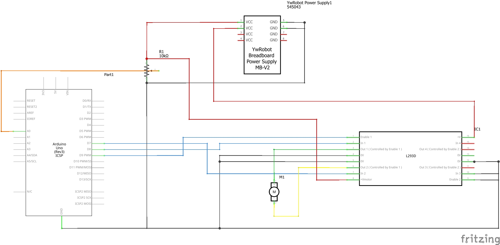

# Project 3 — PWM Motor Controller

Turning a potentiometer changes how fast a DC motor spins, from completely stopped to full speed. A fan blade on the motor shaft makes the speed easy to see: at low speed I could count the individual blades, and at full speed it looks like a solid disc.

This was the first time I made something physical move. My aquarium controller will need to run real devices like a water pump, an air pump and grow lights, so learning how to drive a motor safely comes before any of that.


## What it does

- Reads the potentiometer on A0 (0–1023) and converts it to a PWM value (0–255).
- Sends the PWM from D9 to the L293D motor driver's Enable pin, which controls motor speed.
- Keeps the motor turning one way by setting D8 LOW and D7 HIGH.
- Sets any PWM value below 40 to zero, so the motor either runs or stops instead of humming.
- Prints the ADC reading, PWM value, duty cycle and an estimated voltage to the Serial Monitor every 2 seconds.

## Components

| Component | Quantity |
|---|---:|
| ELEGOO UNO R3 | 1 |
| L293D motor driver chip | 1 |
| Small DC motor with fan blade | 1 |
| 10 kΩ potentiometer | 1 |
| MB-V2 breadboard power supply module | 1 |
| Breadboard and jumper wires | — |
| USB cable and a power source for the module | — |

## Why the motor needs a driver

An Arduino pin is only meant to supply about 20 mA. A motor can draw much more than that, especially when it is starting or stalled. So the Arduino only sends control signals, and the L293D switches the motor current from the separate breadboard power supply. All the grounds are connected so the signals share the same reference.

## Wiring

| From | To |
|---|---|
| Arduino D9 (PWM) | L293D pin 1, Enable 1,2 (speed) |
| Arduino D8 | L293D pin 2, Input 1 (direction) |
| Arduino D7 | L293D pin 7, Input 2 (direction) |
| Motor leads | L293D pins 3 and 6, Outputs 1 and 2 |
| 5 V from power module | L293D pin 16 (logic supply) and pin 8 (motor supply) |
| Ground | L293D pins 4, 5, 12, 13, Arduino GND and power module GND |
| Ground | L293D pin 9 (Enable 3,4) and pins 10, 15 (unused inputs), so the second half of the chip stays off |
| Potentiometer outer legs | 5 V and GND |
| Potentiometer middle leg | Arduino A0 |

Both jumpers on the power module are set to **5 V**. The Arduino is powered over USB and shares ground with the power module.

### Breadboard diagram


### Schematic



**Note:** in the schematic, L293D pin 13 (ground) and pin 15 (unused input) are not drawn connected. The wiring table above is the correct reference.

## How it works

The potentiometer is a voltage divider, so turning it changes the voltage at A0 from 0 to 5 V. `analogRead()` turns that into 0–1023, and `map()` scales it to 0–255 for `analogWrite()`:

```cpp
int pwmValue = map(potValue, 0, 1023, 0, 255);
```

PWM switches the Enable pin on and off very fast, about 490 times per second on pin 9. The duty cycle is how much of each cycle is ON. The motor's coils and its spinning mass smooth out the pulses, so a higher duty cycle gives more power and more speed.

The voltage printed in the Serial Monitor is just `PWM ÷ 255 × 5 V`. It is an ideal estimate, not a measurement. The real motor voltage is lower because the L293D loses some voltage inside the chip.

## Something I discovered: the dead zone

When I first turned the dial to a low position, the motor made a humming sound but the shaft did not spin. I had not read about this anywhere, so I had to figure it out.

It is static friction. A motor at rest has friction in its bearings and brushes. At low PWM, current flows through the coils (which is the hum) but there is not enough force to start the shaft moving. I tried PWM values from 20 upward until it started reliably:

- Below 40: motor hums, shaft does not turn.
- At 40: motor starts reliably.
- That is a duty cycle of 40 ÷ 255 × 100 = **15.7 %**.

So I added a guard that sets anything below 40 to zero. Now the motor either stops cleanly or runs. The value 40 only applies to this motor, supply and load. It does not stop the motor from stalling if something blocks it at higher speeds.

## Something else I found by accident: back-EMF

While the motor was spinning at a fixed dial position, I pressed my finger lightly on the fan blade. It slowed down, and when I let go it sped back up, even though I never touched the potentiometer.

The reason is back-EMF. A spinning motor also acts like a small generator, and that generated voltage pushes back against the supply. When I slowed the motor, the back-EMF dropped, more current flowed and the motor pushed harder, but with the PWM fixed it could not fully get back to its old speed.

This project is **open-loop**: it sets the power but never measures the actual speed. A closed-loop system would measure the speed and adjust the PWM to keep it steady.

## Results

The fan blade made the speed range easy to see:

| PWM | What the fan looked like |
|---:|---|
| 0 | Completely still |
| 84 | Individual blades clearly visible, turning slowly |
| 155 | Blades starting to blur at the edges |
| 255 | Looks like a solid disc |

## Problems I ran into

| Problem | Cause | Fix |
|---|---|---|
| Motor did not run at any dial position | Both power module jumpers were set to 3.3 V. The L293D needs at least 4.5 V for its logic supply | Moved the jumpers to 5 V. The motor started immediately |
| Motor hummed but did not spin at low settings | Not enough force to overcome static friction | Added the dead zone guard at PWM 40 |

The first problem taught me to check the power supply before assuming the code or circuit is wrong. It was a single jumper in the wrong position.

## How to run it

1. Build the circuit with the power **disconnected**, using the wiring table.
2. Check that both power module jumpers are on 5 V and all grounds are connected.
3. Open [`PWM_Motor_Controller.ino`](PWM_Motor_Controller.ino), select the board and port, and upload over USB.
4. Turn the potentiometer to its minimum before switching on the motor power.
5. Open the Serial Monitor at **9600 baud** and turn the dial slowly. The sketch only updates every 2 seconds, so give it a moment.

No extra libraries are needed. Keep fingers away from the blade unless you are doing the back-EMF test gently, and switch off power before fixing a stalled motor.

## What I would improve

- **Measure the speed** with an encoder or a light sensor on the blade, then adjust PWM automatically (closed-loop control).
- **Replace `delay(2000)` with `millis()`** so the dial responds right away. I learned how to do this later, in Project 5.
- **Measure the motor current** to detect a stall instead of just hoping it doesn't happen.

## What I learned

This was the first project where one input directly controlled something physical. The aquarium I lost in Grade 8 had equipment running at fixed power with no feedback: the filter ran at one speed and the light was either on or off. This project is the first step away from that.

The dead zone taught me the most. Noticing the hum, figuring out it was friction, testing to find the threshold and then writing the guard taught me more than reading about motors ever did.

## Files

| File | What it is |
|---|---|
| [PWM_Motor_Controller.ino](PWM_Motor_Controller.ino) | My original Arduino sketch. The listing in the report is a tidied copy with the Serial output on one line; the motor control code is the same |
| [Project report R1](Project3_PWM_Motor_Controller_R1.docx) | Full write-up |
| [Build photo](Project3_PWM_Motor_Controller_Image.jpeg) | The finished circuit with the fan |
| [Breadboard diagram](Project3_PWM_Motor_Controller_Breadboard.jpg) | Circuit layout |
| [Schematic](Project3_PWM_Motor_Controller_Schema.jpg) | Electrical connections |
| [Demo video](Project3_PWM_Motor_Controller_Video.mp4) | The fan changing speed as I turn the dial |
