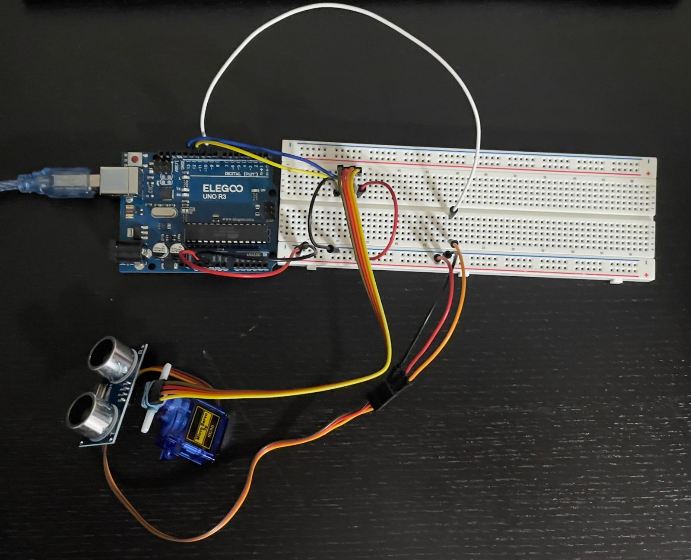
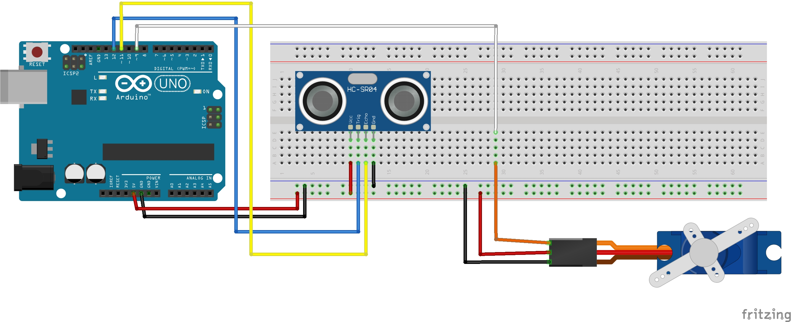
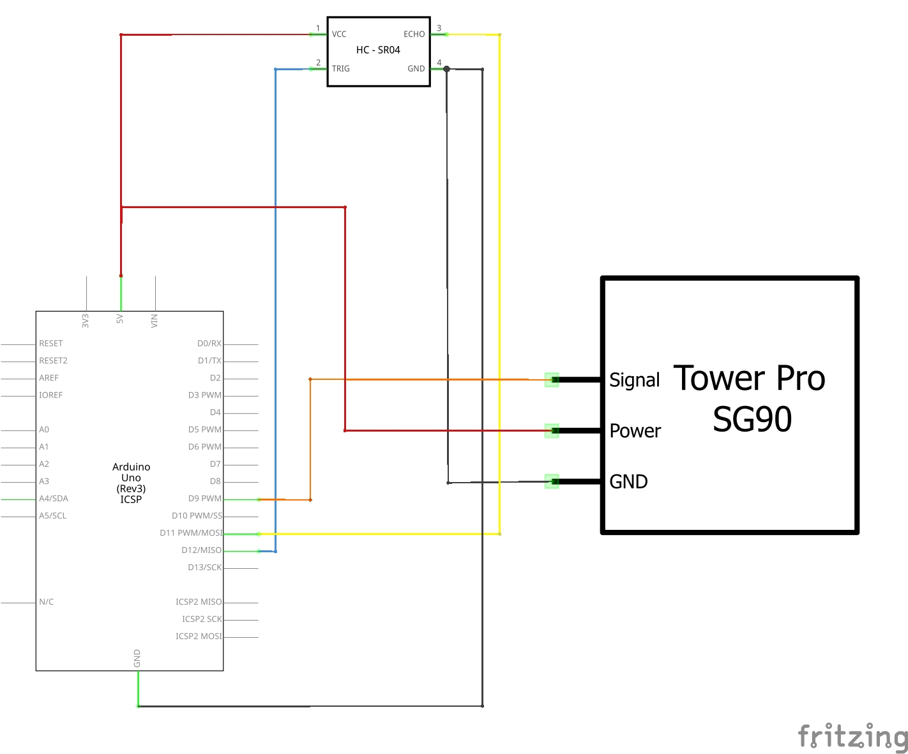
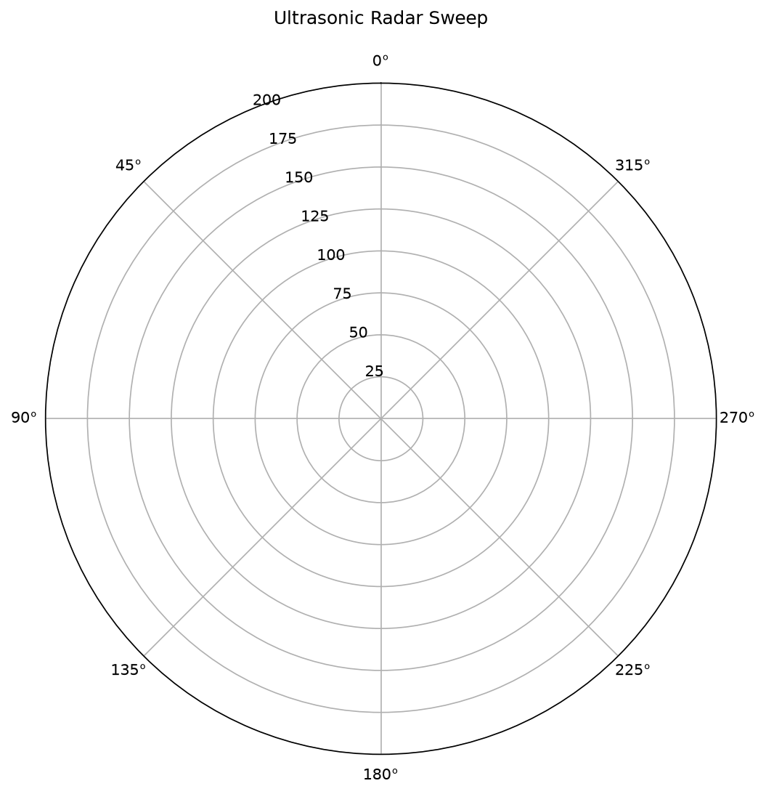
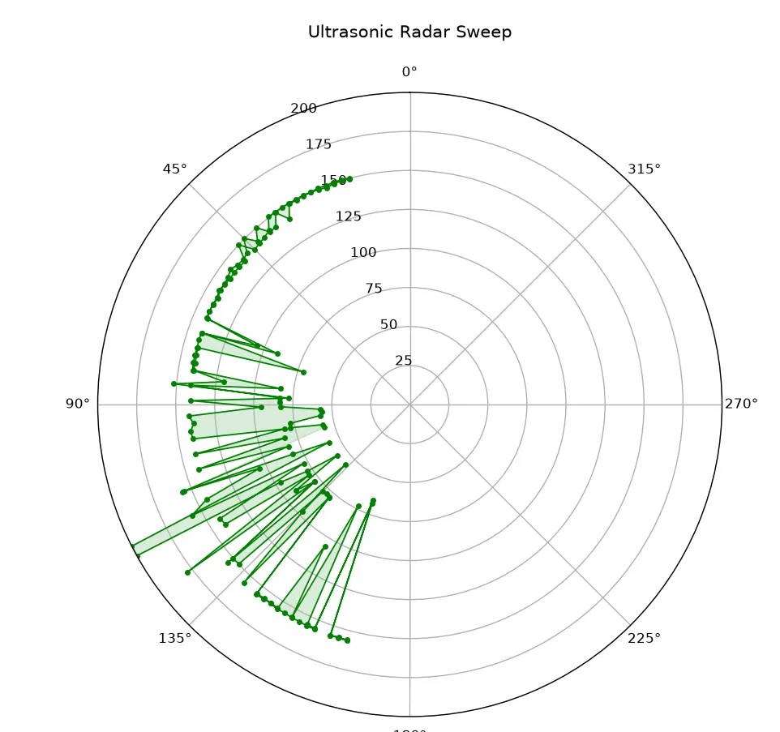

# Project 4 — Ultrasonic Radar Sweep

A servo sweeps an HC-SR04 ultrasonic sensor from 15° to 165° and back in 2° steps. At each angle the sensor measures how far away the nearest object is, and a Python script on my computer plots the readings on a live polar chart, like a radar screen.

It uses sound, not radio waves. "Radar" just describes the style of the display. This was the first project where I combined something that moves (the servo) with something that measures (the sensor) to scan a space.



## What it does

- Sweeps a 150° area in both directions, 2° at a time.
- Measures distance from how long an ultrasonic echo takes to come back.
- Sends `angle,distance` lines to the computer at 9600 baud.
- Gives up on an echo after 30 ms, so the Arduino never waits forever.
- Marks failed or out-of-range readings as 400 cm.
- The Python script plots the latest 150 readings on a polar chart.

## Components

| Component | Quantity |
|---|---:|
| ELEGOO UNO R3 | 1 |
| HC-SR04 ultrasonic sensor | 1 |
| SG90 servo | 1 |
| Breadboard and jumper wires, including female-to-male leads for the sensor | — |
| Tape (and a rubber band) to hold the sensor on the servo horn | — |
| USB cable | 1 |

Software: Arduino IDE (the Servo library is built in) and Python with `pyserial` and `matplotlib`.

## Wiring

| From | To |
|---|---|
| HC-SR04 VCC | 5 V |
| HC-SR04 GND | GND |
| HC-SR04 TRIG | D12 |
| HC-SR04 ECHO | D11 |
| Servo signal (orange) | D9 |
| Servo power (red) | 5 V |
| Servo ground (brown) | GND |

### Breadboard diagram



The diagram shows the sensor sitting in the breadboard so the connections are easy to see. In the real build, the sensor sits on the servo horn so it turns with the servo.

### Schematic



## How the distance is calculated

The sensor sends out a burst of sound and times how long the echo takes to come back. The sound travels to the object **and back**, so the real distance is half the total path:

```text
distance = echo time × speed of sound ÷ 2
```

At 20 °C, sound travels at 343.42 m/s, which is **0.034342 cm per microsecond**. Many tutorials just divide by 58, but I wrote the formula out in full in my code so anyone reading it can see the physics instead of a mystery number. (2 ÷ 0.034342 = 58.24, which is where that number comes from.)

Sound travels faster in warmer air, so a fixed 20 °C value adds a small error on warm days. A future version could correct for air temperature:

```cpp
float speedOfSound = 0.03313 + 0.0000606 * temperature;  // temperature in °C
```

## Mounting the sensor on the servo

This was the trickiest part of the build, and it was a mechanical problem, not a code problem. I took the HC-SR04 out of the breadboard, plugged female-to-male wires onto its four pins, and attached it to the servo horn with the sensors facing forward.

The most important detail was **leaving a small loop of wire near the servo**. Before I added the loop, the servo stalled at about 90° and the wires started pulling loose. After the loop, it swept the full 150° with no problems.

The rubber band holding the sensor became a lesson later. When I reused this servo for Project 9, the band was still on it and jammed the arm, and the stalled servo pulled so much current that my Arduino lost power.

## How to run it

1. Build the circuit with the USB cable unplugged.
2. Attach the sensor to the servo horn and check the wires stay loose through the whole sweep.
3. Open [`Radar1.ino`](Radar1.ino), select the board and port, and upload.
4. Open the Serial Monitor at **9600 baud** to check that `angle,distance` lines appear, then **close it**. Only one program can use the port at a time.
5. Install the Python libraries:

   ```sh
   py -m pip install pyserial matplotlib
   ```

6. Open [`radar.py`](radar.py) and change `PORT = 'COM6'` to your Arduino's port.
7. Run it with `py radar.py`. Press **Ctrl+C** in the terminal to stop. The script then saves `radar_sweep.png`.

**Honest note about Python:** Python is still new to me. I understand what the script does (it reads each line, converts the angle to radians because Matplotlib's polar charts use radians, and plots the latest 150 points), but I could not have written it from scratch on my own yet.

## Reading the charts

### Empty chart grid



### Chart with real readings



Distances are in centimetres. The script puts 0° at the top and counts counterclockwise, so my 15°–165° sweep shows up on the **left side**. The full circle is just the chart grid. The sensor does not scan 360°.

A few things in the chart are caused by how I plot, not by real objects:

- The chart is capped at 200 cm, so anything farther away **and** every failed reading (sent as 400 cm) shows up on the outer edge.
- The script connects every point in order, across both sweep directions, and fills the shape. So the zigzags are plotting artifacts, not the actual outline of an object.

## Results

**Checking the distance formula:**

| Real distance | Expected echo time | Measured echo time | Calculated distance | Error |
|---:|---:|---:|---:|---:|
| 18 cm | 1048 µs | 1053 µs | 18.08 cm | +0.08 cm |
| 26 cm | 1514 µs | 1516 µs | 26.03 cm | +0.03 cm |

Both errors are under a millimetre. At first I thought temperature caused them, but when I checked the direction of the effect, warmer air would make the sensor read **too short**, not too long. So two readings are not enough to say what caused such a small difference. It could be alignment, the target's surface or timing.

**Finding an edge:**

| Angle | Distance | Change |
|---:|---:|---:|
| 64° | 22.3 cm | — |
| 66° | 126.7 cm | +104.4 cm |
| 68° | 128.1 cm | +1.4 cm |

The jump of more than a metre in one 2° step is where the beam went past the edge of the object and started hitting the far wall. The sensor's beam is wide, though, so this shows roughly where the edge is, not its exact position.

## Problems I ran into

| Problem | Cause | Fix |
|---|---|---|
| Sketch would not compile | I had pasted test code below my working code, so the file had two `setup()` functions | Deleted the duplicate. Now I check the whole file when I get a duplicate error, not just the line it points to |
| Servo swept but every reading was the same | The sensor was still sitting in the breadboard, so it always pointed the same way | Moved it onto the servo horn with female-to-male wires and added a wire loop |
| Python chart stayed empty | Some serial reads were empty or incomplete lines | Skip any line that is empty or has no comma. The chart started filling immediately |

## What I would improve

- **Timing:** the HC-SR04 datasheet recommends at least 60 ms between measurements. My sketch only waits 30 ms after each servo move, so the next version should space the triggers properly.
- **Invalid readings:** 400 cm means both "no echo" and "something really is 400 cm away". A separate valid/invalid field would fix that.
- **The chart:** filter out invalid readings and draw the two sweep directions separately instead of joining everything.
- **Temperature:** add the air-temperature correction above.

## Connection to the aquarium

An HC-SR04 mounted above the tank could measure the **water level**: the distance down to the water surface tells me how full it is. Warm aquarium water heats the air above it, which changes the speed of sound, so it would need the temperature correction, measured in the air, not the water.

## What I learned

The mechanical part, getting the sensor to turn with the servo without the wires pulling tight, was the most physical problem in my portfolio so far. Solving it with a wire loop felt different from fixing code.

Working out the distance formula myself was the part I am most proud of. Checking my results also taught me to check the direction of an effect before blaming it for an error.

## Files

| File | What it is |
|---|---|
| [Radar1.ino](Radar1.ino) | Arduino sketch |
| [radar.py](radar.py) | Python polar chart script |
| [Project report R1](Project_4_Ultrasonic_Radar_R1.docx) | Full write-up |
| [Build photo](Project_4_Ultrasonic_Radar_Image.jpeg) | Sensor mounted on the servo |
| [Breadboard diagram](Project_4_Ultrasonic_Radar_Breadboard.jpg) | Circuit layout |
| [Schematic](Project_4_Ultrasonic_Radar_Schema.jpg) | Electrical connections |
| [Chart 1](Project_4_Ultrasonic_Radar_Chart_1.png) | Empty polar chart grid |
| [Chart 2](Project_4_Ultrasonic_Radar_Chart_2.webp) | Chart with real readings |
| [Video 1](Project_4_Ultrasonic_Radar_Video_1.mp4) | Servo sweeping before the sensor was mounted on it |
| [Video 2](Project_4_Ultrasonic_Radar_Video_2.mp4) | Sensor mounted on the servo, sweeping |
