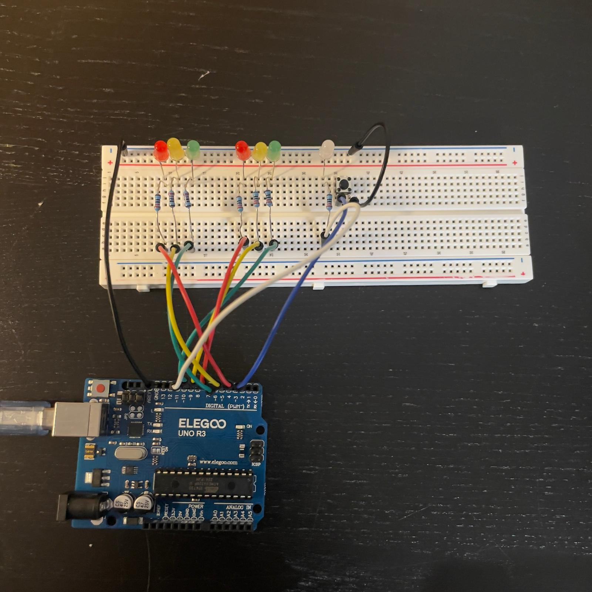
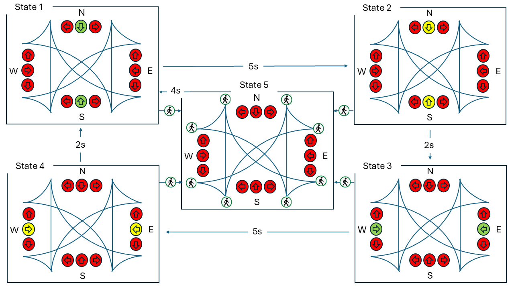
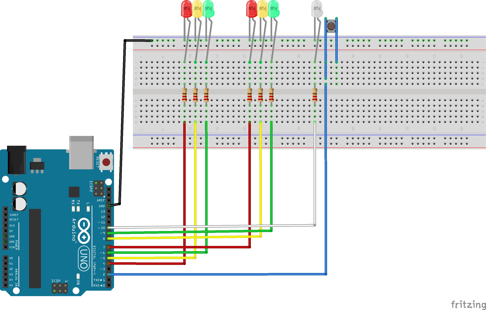
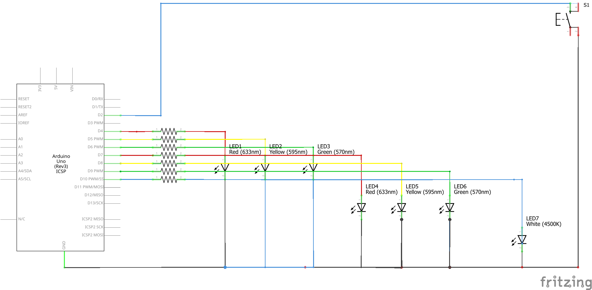

# Project 5 — Smart Traffic Light

Two sets of traffic lights take turns at a pretend four-way intersection: one for North–South (NS) traffic and one for East–West (EW). They change automatically on a timer. Pressing a pedestrian button turns both directions red and switches on a white WALK light for 4 seconds, then the normal cycle starts again.

This project was the most different from everything I had built before. My earlier projects mostly read sensors and showed values. This one controls a system over time, with rules for when to change. That is exactly the kind of thinking my aquarium controller needs.



## What it does

| State | NS light | EW light | WALK | How long |
|---|---|---|---|---|
| NS green | Green | Red | Off | 5 s |
| NS yellow | Yellow | Red | Off | 2 s |
| EW green | Red | Green | Off | 5 s |
| EW yellow | Red | Yellow | Off | 2 s |
| Pedestrian | Red | Red | **On** | 4 s |

The first four states repeat forever. Pressing the button during any of them jumps to the pedestrian state. Extra presses during WALK are ignored, so they cannot keep restarting the 4-second timer. After WALK, the cycle goes back to NS green.

## Four new ideas in this project

**1. Finite state machine (FSM).** The program can only ever be in one state at a time, and there are clear rules for moving between them. Without this, a traffic light program turns into a mess of nested `if` statements that gets harder to change every time you add a feature. With the state machine, adding the whole pedestrian feature only meant adding one new state and a few rules.

**2. `enum` for state names.** Instead of writing `if (state == 2)`, which tells you nothing, I can write `if (state == EW_GREEN_STATE)`. The compiler still turns the names into numbers, but the code reads like a description of what is happening.

**3. `millis()` instead of `delay()`.** `delay(5000)` freezes the whole program for 5 seconds. With `millis()`, I record when a state started, and every time `loop()` runs I check how much time has passed. If it's enough, I move to the next state. If not, `loop()` finishes and runs again straight away. Once I understood the pattern (*record the start, check the time, act when enough has passed*), it became natural.

**4. Hardware interrupt.** The button is on pin 2, one of only two pins on the UNO (2 and 3) that support hardware interrupts. When the pin goes from HIGH to LOW (the button is pressed), the Arduino immediately runs a tiny function that just sets a flag:

```cpp
volatile bool pedRequest = false;

void pedestrianRequest() {
  pedRequest = true;   // loop() sees this on its next pass and does the actual work
}
```

I kept the interrupt function as short as possible. It only *records* the request; the main loop *handles* it. That separation between catching an event and responding to it was the main lesson of this project.

## State diagram



I drew this diagram before writing any code. Every box is a state, every arrow is a change and every label is the timing rule. The turn arrows in the drawing show the idea of a real intersection. My hardware has one light per direction plus the WALK LED, not separate turn arrows. The original slides are in [`Project_5_Traffic_Light_State_Transition.pptx`](Project_5_Traffic_Light_State_Transition.pptx).

## Components

ELEGOO UNO R3, two red, two yellow and two green LEDs, one white LED, seven 220 Ω resistors (one per LED), one push button, a breadboard, jumper wires and a USB cable.

## Wiring

| Pin | Connected to |
|---|---|
| D4 | NS red LED (through 220 Ω) |
| D5 | NS yellow LED (through 220 Ω) |
| D6 | NS green LED (through 220 Ω) |
| D7 | EW red LED (through 220 Ω) |
| D8 | EW yellow LED (through 220 Ω) |
| D9 | EW green LED (through 220 Ω) |
| D10 | White WALK LED (through 220 Ω) |
| D2 | Push button (other side to GND) |
| GND | All LED cathodes and the button |

The button uses `INPUT_PULLUP`, so the pin reads HIGH when the button is up and LOW when it is pressed. No extra resistor is needed.

### Breadboard diagram



### Schematic



**Note:** in the schematic, the D10 (WALK) line is drawn running through the bottom pins of LED1–LED3, which makes it look connected to ground. It is not connected that way in the real circuit. The breadboard diagram and the pin table above are the correct reference.

## How I built it

I built and tested it in three stages, confirming each part worked before adding the next.

| Stage | What I tested | Evidence |
|---|---|---|
| 1 | NS lights only (pins 4, 5, 6): red, yellow, green in a simple loop | [Photo](Project_5_Traffic_Light_First_LED_Set_Image.jpeg) · [Video](Project_5_Traffic_Light_First_LED_Set_Video.mp4) |
| 2 | Added the EW lights (pins 7, 8, 9) and checked that when NS was green, EW was red, and the other way round. Also checked the Stage 1 LEDs still behaved the same | [Photo](Project_5_Traffic_Light_Two_LED_Set_Image.jpeg) · [Video](Project_5_Traffic_Light_Two_LED_Set_Video.mp4) |
| 3 | Uploaded the full state machine with the WALK LED and button, and watched the state names print in the Serial Monitor | [Photo](Project_5_Traffic_Light_Traffic_Signal_Image.jpeg) · [Video](Project_5_Traffic_Light_Traffic_Signal_Video.mp4) |

In Stage 3 I pressed the button at different points in the cycle. Every time, both directions turned red and the WALK light came on, and after 4 seconds the cycle restarted from NS green.

## Results

I checked the timing using the Serial Monitor timestamps:

| State | Expected | Measured |
|---|---:|---:|
| NS green | 5000 ms | 5021 ms |
| NS yellow | 2000 ms | 2011 ms |
| EW green | 5000 ms | 5018 ms |
| EW yellow | 2000 ms | 2009 ms |
| Pedestrian | 4000 ms | 4014 ms |

Every state was within about 20 ms of its target. These numbers are approximate, because the Serial Monitor timestamps are added by the computer, not the Arduino, so they include delays from the USB connection. A logic analyser would give exact timing.

## How to run it

1. Wire the circuit with the USB unplugged, checking the LED directions (long leg towards the Arduino pin).
2. Open [`Traffic_Signal_3.ino`](Traffic_Signal_3.ino), select the board and port, and upload. No extra libraries are needed.
3. Open the Serial Monitor at **9600 baud**. You should see `Smart Traffic Light Started` and `State: NS_GREEN`.
4. Watch one full 5 s / 2 s / 5 s / 2 s cycle.
5. Press the button during each state and check that WALK comes on for about 4 seconds.
6. Press it again during WALK and check that the timer does not restart.

## What I would improve

- **Debouncing:** ignoring presses during WALK stops repeat triggers, but it is not real debouncing.
- **Safer transitions:** a real traffic light would go through yellow, then all red, before WALK. Mine jumps straight to red to keep the model simple.
- **Reading the flag safely:** `volatile` makes sure the main loop sees the latest value of `pedRequest`, but an interrupt could still happen between reading and clearing it. A future version could pause interrupts for that moment.

## Connection to the aquarium

The aquarium has different modes depending on the time of day: lights on, CO₂ on, night mode. That is a state machine, just with longer timers. And the controller has to watch temperature, check pH, keep track of the clock and respond to alerts all at once, so it can never freeze inside a `delay()`. This project is where I learned both patterns, and I reused the state machine idea in my keypad lock (Project 9), where key presses move it between states instead of a timer.

## Files

| File | What it is |
|---|---|
| [Traffic_Signal_3.ino](Traffic_Signal_3.ino) | Final Arduino sketch |
| [Project report R1](Project_5_Traffic_Light_R1.docx) | Full write-up |
| [State transition slides](Project_5_Traffic_Light_State_Transition.pptx) | PowerPoint version of the state diagram |
| [State diagram](Project_5_Traffic_Light_State_Transition_Diagram.png) | The five states and their transitions |
| [Breadboard diagram](Project_5_Traffic_Light_Traffic_Signal_Breadboard.png) | Circuit layout |
| [Schematic](Project_5_Traffic_Light_Traffic_Signal_Schema.png) | Electrical connections |
| [Stage 1 photo](Project_5_Traffic_Light_First_LED_Set_Image.jpeg) · [video](Project_5_Traffic_Light_First_LED_Set_Video.mp4) | NS lights only |
| [Stage 2 photo](Project_5_Traffic_Light_Two_LED_Set_Image.jpeg) · [video](Project_5_Traffic_Light_Two_LED_Set_Video.mp4) | NS and EW lights |
| [Final photo](Project_5_Traffic_Light_Traffic_Signal_Image.jpeg) · [video](Project_5_Traffic_Light_Traffic_Signal_Video.mp4) | Full build with WALK LED and button |
