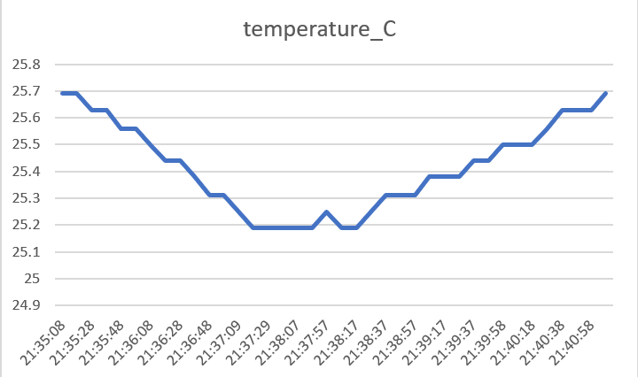
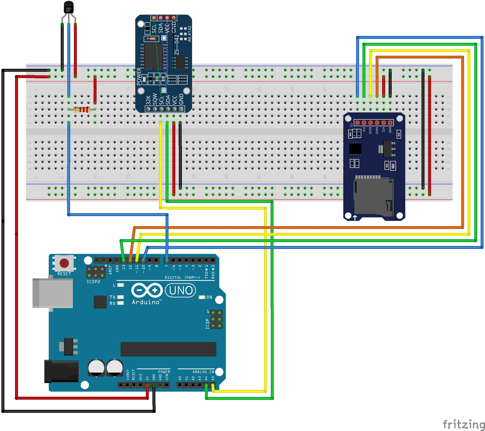
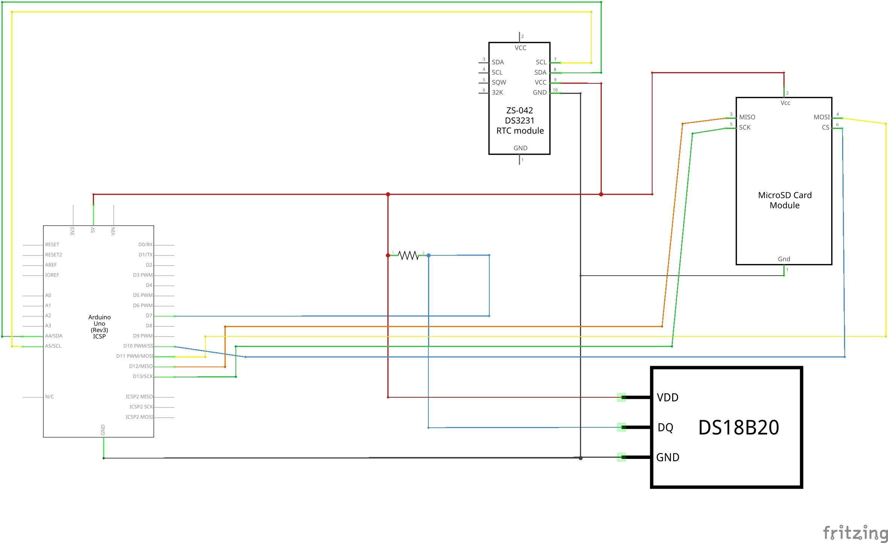
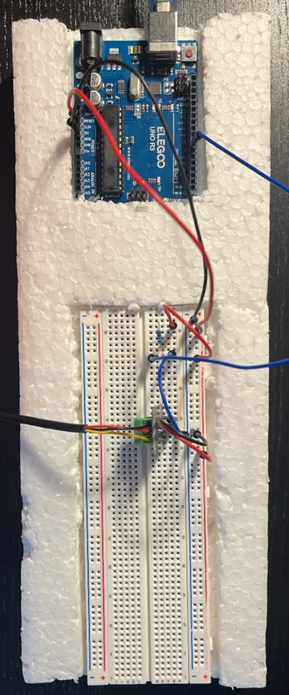
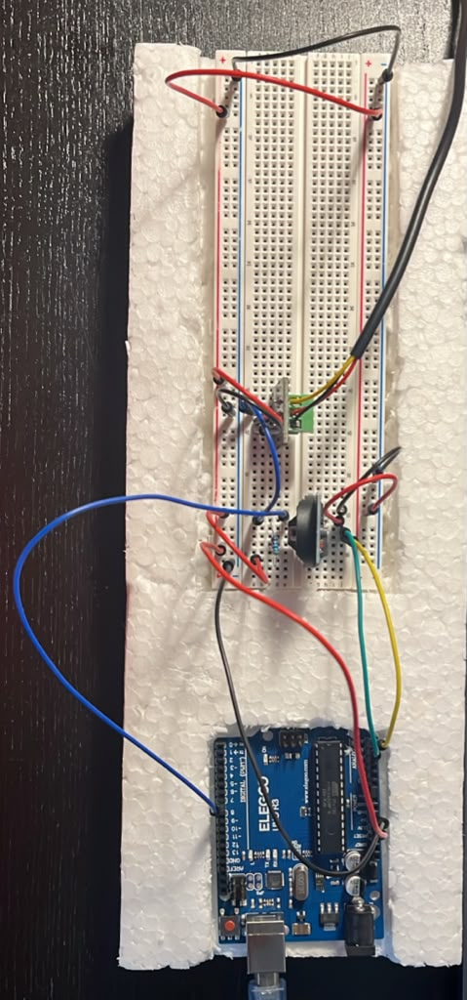
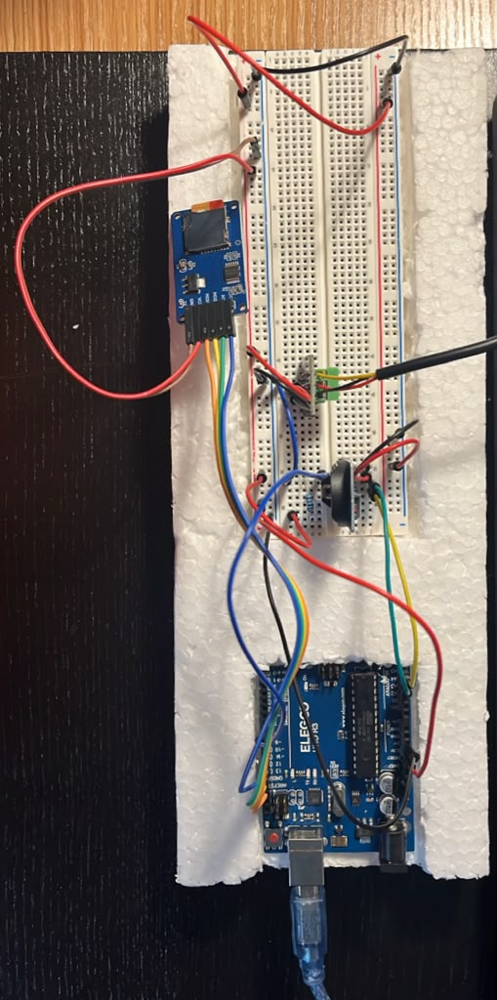

# Project 6 – Water Temperature Logger

**DS18B20 probe · DS3231 real-time clock · SD card · Arduino UNO R3**

October 12, 2026

This is the first project in my portfolio that runs on its own. There's no laptop and no Python script. Every 10 seconds the Arduino reads the temperature, gets the date and time from a real-time clock, and saves one line to `log.csv` on an SD card. Afterward I take the card out and graph the data in Excel.

## What I noticed

- **The temperature dipped, then came back.** It fell from 25.69 °C to 25.19 °C in the first two minutes, then climbed back to 25.69 °C. The drop makes sense, because I had been holding the probe while wiring it. I don't know for sure why it rose again, and I didn't measure the room temperature.
- **My log shows the clock jumping backward.** Three times in a row, the timestamp went back to 21:37:57. I had left `rtc.adjust()` in the sketch, so every time the board reset, the clock went back to the time the code was compiled. The data proved the bug before I noticed it.
- **The clock was about 26 seconds behind my laptop.** This has the same cause: `rtc.adjust()` uses the compile time, not the time the upload finished.
- **Each reading took a little more than 10 seconds.** On Serial Monitor the gap was about 10.1 s, because reading the probe and writing the card take time on top of `delay(10000)`. In the capstone I'll use `millis()` timing from Project 5 instead.
- **The SD card mattered most.** Every earlier project only showed numbers on a screen. This one left me a real file I could pull out and look at later.

## Why this matters for my aquarium

My planted aquarium failed in Grades 7–8, and temperature was one of the problems. I never saw it happen, because nothing was recording the water. This project is the first piece of the fix:

- **The DS18B20 probe** is the same probe I plan to put in the tank.
- **The DS3231 clock** will schedule the grow light and CO₂. It doesn't adjust for daylight saving time by itself, so I'll handle that in code.
- **The SD log** will record temperature, pH and every relay switch. Then I can see when something started to drift, not just when it was already too late.

## Three ways to talk to chips

Each part uses a different protocol, so I had to learn all three:

| Part | Protocol | Wires | Arduino pins |
|---|---|---|---|
| DS18B20 probe | OneWire | 1 data | D7, plus a 4.7 kΩ pull-up to 5V |
| DS3231 clock | I²C | 2 (SDA, SCL) | A4, A5 |
| SD card module | SPI | 4 (CS, MOSI, MISO, SCK) | D10, D11, D12, D13 |

- **OneWire:** the sensor and the Arduino take turns on one wire. The pull-up holds the line HIGH between turns. Without it, the line floats and the sensor is never found.
- **I²C:** many chips can share two wires because each one has its own address. The DS3231 is at 0x68.
- **SPI:** four wires, and it's fast. The CS pin picks which device to talk to. The card runs at 3.3V, and the module shifts the Arduino's 5V signals down to that level.

## Circuit

| Breadboard (Fritzing) | Schematic (Fritzing) |
|---|---|
|  |  |

Fritzing shows the small TO-92 version of the DS18B20. My waterproof probe has the same three wires: red to 5V, black to GND, and yellow (data) to D7.

## How I built it: three stages

I added one part at a time, so when something broke I knew which part caused it.

| Stage 1: probe only | Stage 2: + clock | Stage 3: + SD card |
|---|---|---|
|  |  |  |

## Problems I ran into

1. **The sensor count showed 0.** The pull-up resistor's leg wasn't in the same breadboard row as the data wire. When I moved it, the count changed to 1. Now the pull-up is the first thing I check.
2. **The SD card wasn't found.** MOSI and MISO sit next to each other on D11 and D12, and I had swapped a wire. I re-seated all six SD wires one at a time and checked each label.
3. **The clock rewound on every reset.** `rtc.adjust()` was still in the code (see the graph). I left it in the sketch here because that is the exact code this data came from. Before the capstone I'll run it once to set the clock and then comment it out.
4. **There were extra header rows in the CSV.** `FILE_WRITE` adds to the end of the file, so every reset wrote another `date,time,temperature_C` line. I deleted the extras in Excel. Next time I'll check `SD.exists("log.csv")` and only write the header for a new file.

## Files

| File | What it is |
|---|---|
| `Water_Temperature_Logger.ino` | The exact sketch that logged this data (`rtc.adjust()` is still active) |
| `LOG.csv` | 38 readings from October 12, 2026. I opened and re-saved it in Excel, so the dates show as 10/12/2026 instead of the Arduino's 2026/10/12, and Excel added the leading zeros to the times. |
| `Project_6_Water_Temperature_Logger_R1.docx` | Full project report |
| `Project_6_Water_Temperature_Logger_Breadboard.jpg`, `Project_6_Water_Temperature_Logger_Schema.jpg` | Fritzing breadboard and schematic |
| `Project_6_Water_Temperature_Logger_Stage_1.jpeg`, `_Stage_2.jpeg`, `_Stage_3.jpeg` | Photos of each build stage |
| `Project_6_Water_Temp_Logger_Temperature_Graph.png` | Graph of `LOG.csv` |

## What I'd do next time

- Write the CSV header only once.
- Log every 60 seconds instead of 10. A day at 60 s is 1,440 rows instead of 8,640.
- Zero-pad the time (21:38:07, not 21:38:7) so the raw file is cleaner.
- Check the probe against a known thermometer. The datasheet says it's accurate to ±0.5 °C.

**Libraries:** OneWire, DallasTemperature (Miles Burton), RTClib (Adafruit), SD and SPI (built into the Arduino IDE).
